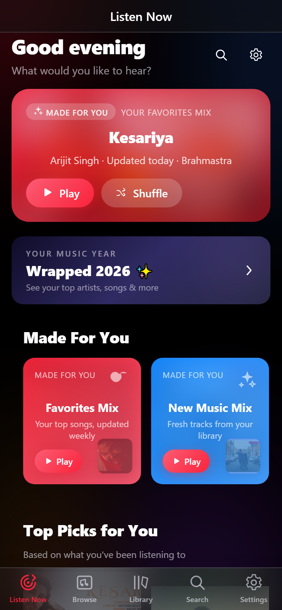
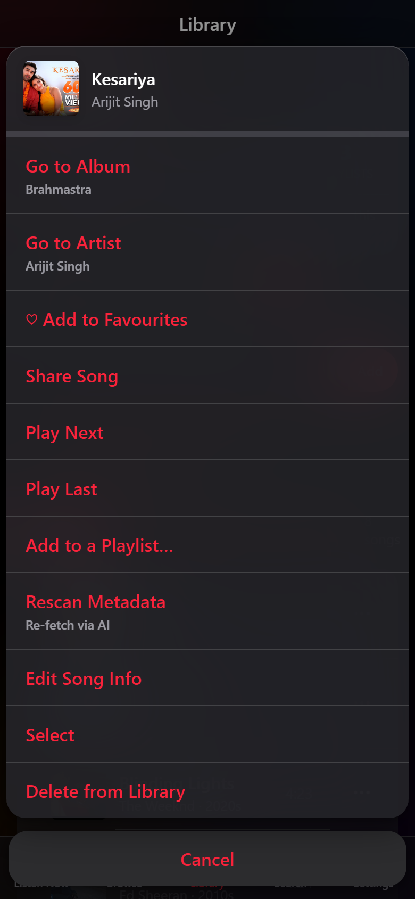
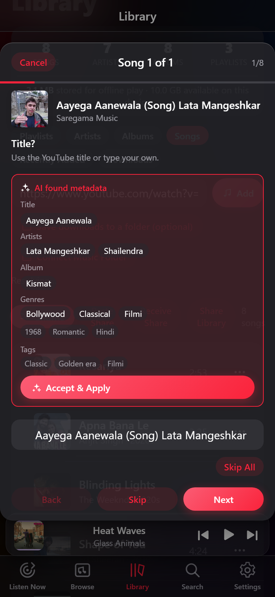

# Vispr — Liquid Glass Music PWA

A fully offline-capable Progressive Web App (React + TypeScript + Vite) with an Apple Music–inspired Liquid Glass interface that turns your own music files into a beautiful streaming-style experience on phones **and** desktops — with AI-assisted metadata and YouTube imports.

| Listen Now | Song Actions | AI Metadata |
|---|---|---|
|  |  |  |

## ⚠️ Personal & Educational Use Only

> **This project is for personal and educational use only.**
>
> - Songs and other audio content streamed or downloaded via services like YouTube are **protected by copyright** and belong to their respective owners (artists, labels, publishers).
> - This tool does **not** grant you any rights to copy, redistribute, share, sell, or publicly play copyrighted material.
> - Downloading content from YouTube may violate [YouTube's Terms of Service](https://www.youtube.com/static?template=terms) and local copyright laws, depending on your jurisdiction.
> - Use it only for content you own, content that is public domain / Creative-Commons licensed, or for learning how the app is built.
> - The authors of this repository assume **no liability** for misuse. You are solely responsible for how you use this software.
>
> **No commercial use. No redistribution of downloaded media. Support artists by streaming or purchasing through official channels.**

## Features

### Core Experience
- **Liquid Glass UI** — Apple Music–style Listen Now / Browse / Library / Search with translucent blurred surfaces over an ambient color field, springy press feedback everywhere, glass sheets & cards; switches to a macOS-style sidebar + player bar on desktop.
- **Your files, your library** — connect your phone's `Music` folder once via the native folder picker (File System Access API). The connection persists across sessions. Individual file picking is also supported as a fallback.
- **Fully responsive** — optimized layouts for phones (375px–430px), tablets, and desktops.
- **Offline artwork** — all cover art is stored as data URLs in IndexedDB, so thumbnails and banners appear fully offline.
- **Persistence** — library index, playlists, queue, playback history, play counts, shuffle/repeat/crossfade/volume all survive app restarts. Resumes where you left off.
- **Installable PWA** — service worker precache, offline shell, install banner (native prompt on Android, "Add to Home Screen" instructions on iOS).

### Playback
- **Crossfade** — optional toggle in Now Playing; the next track fades in as the current one fades out (no silence gap).
- **Lock-screen media controls** — MediaSession integration with artwork, play/pause/next/previous/seek and position scrubber on the Android notification & lock screen.
- **Queue management** — Play Next / Play Last from any track's ⋯ menu, drag-to-reorder Up Next, remove items.
- **Shuffle & Repeat** — shuffle toggle and repeat off/all/one from Now Playing.
- **Keyboard shortcuts** (desktop) — see [Shortcuts](#keyboard-shortcuts).

### YouTube Imports & AI Metadata
- **Paste any YouTube video or playlist URL** — audio is downloaded server-side (yt-dlp bridge), tagged (title/artist/album + embedded cover art) via mutagen, deduplicated, and stored offline. Radio-mix links (`list=RD…`) import as a single song.
- **AI metadata analysis (Gemini)** — during import, each song is analyzed by Gemini: genre, era, mood, language, album, featured artists, mashup/remix detection. Suggestions appear as an "AI found metadata" card you can apply with one tap — or the wizard just asks you to confirm each field.
- **AI Rescan** — any song's ⋯ menu → **Rescan Metadata** re-fetches its metadata via AI (useful for old imports with wrong tags).
- **Manual Song mode** — paste a YouTube URL and type the metadata yourself (AI auto-fills blanks if configured). No backend server needed.
- **Smart review wizard** — review/edit every song before it downloads; bulk answers (album/genre/artist) propagate to the whole playlist.
- **Download queue that survives an offline server** — the download backend runs on a tunnel that can drop at any time (sleeping laptop, restarted machine), so the app treats it as optional:
  - **Search keeps working while the server is down** — search goes through the deployment's own API plus an in-memory/IndexedDB cache, never the tunnel.
  - **Songs queue up anyway** — each pending track (URL + metadata) is persisted locally in IndexedDB, so nothing is lost if you close the app or restart your device.
  - **Server-up notification** — when the backend becomes reachable again you get a push notification: *"Server is back online — open the app to resume downloading your music."* (Works while the app is closed; requires **Enable Notifications** in Settings → Import, iOS 16.4+.)
  - **One tap to resume** — open the app → **Library → Downloads** → **Start Downloads**. As a safety net, while that page is open the app health-checks the server every 10 seconds and auto-starts the queue the moment it comes back.
  - The queue (pending / failed / completed, with a progress bar) is visible under **Library → Downloads**.
- **Save downloads to a folder** (optional) — every imported song is also written to a folder you pick on your device (File System Access API).

### Library Management
- **Library insights** — songs/artists/albums/playlists counts + offline storage usage; delete any track from its ⋯ menu.
- **Multi-select** — ⋯ → Select on a track, then batch-play, batch-favourite, batch-add-to-playlist, or batch-delete.
- **Supported formats** — `.mp3` `.m4a` `.mp4` `.aac` `.flac` `.wav` `.ogg` `.opus` `.webm`. Metadata is read from embedded ID3v2, MP4/iTunes and FLAC Vorbis tags; falls back to parsing `Song - Artist.mp3`-style filenames.
- **Full metadata editor** — title, multiple artists, album, year/era, two genre slots, song type (Lofi/Remix/Mashup/…), mood, language, free-form tags, and cover art (from photos or a YouTube URL).

### Smart Features
- **NLP-powered recommender** — "Made For You" (Favorites Mix), Top Picks, and Discovery Mix run a TensorFlow.js **Universal Sentence Encoder** model fully on-device: every track's title/artists/album/genres/mood/tags are embedded into a semantic vector, and songs are ranked by **cosine similarity to the centroid of your favourites**, blended with play-count artist/genre/era affinity, playlist co-occurrence, recency penalties, and a small exploration bonus. If the model can't load, it falls back to the heuristic ranking. No listening data ever leaves your device.
- **Mix refresh cadence** — mixes are recomputed automatically **every time you open the app** (each Listen Now session), re-ranked against your latest plays and favourites — there is no fixed weekly timer; the "updated weekly" subtitle is Apple-Music-style copy.
- **Mood & Genre chips** — horizontal filters on Listen Now backed by a **mood-matching engine** that scores each track's mood/genre tags (mood tags are themselves AI-assigned by Gemini at import time) against the chip's mood — Chill, Focus, Workout, Party, Commute, Sleep, and more.
- **Stations for You** — a personal shuffle station plus genre stations (Bollywood, Rock, Chill, Party) matched via the built-in keyword classifier + the same mood-matching engine (no network needed).
- **Recently Played / Jump Back In / Recently Added** — artwork-forward sections on Listen Now.
- **Year/Era metadata** — era badges (2020s, 2010s, 90s…) everywhere; year is editable.

### Organization
- **Playlists** — create from anywhere; add songs via ⋯ menu or batch select.
- **Album / Artist detail pages** — with Play, Shuffle, and Share.
- **Mix detail pages** — smart mixes (Made For You, Top Picks, Stations) open in a dedicated play view.

### Sharing
- **Share songs, playlists, albums, artists, and mixes** — ⋯ menu or Share buttons; uses `navigator.share()` on phones (sends audio via AirDrop/etc.), falls back to a `.vispr.json` file on desktop.
- **Paste Share (text)** — shares also compress into a copy-pasteable text blob — paste it in any chat; the receiver taps **Paste Share** to import, no file needed.
- **Conflict detection** — incoming shares are matched against your library: exact matches, conflicts (same song, different metadata), and new tracks — keep yours or accept theirs, individually or all at once.
- **Playlist merge** — receiving a playlist share auto-creates or merges into an existing playlist of the same name.
- **Share Library** — one tap on the Songs page exports your whole library for another device.
- **Private by design** — share payloads are built entirely on your device. They're compressed locally (LZ-string) and handed straight to your system share sheet or clipboard — nothing is uploaded to any server of ours, and no share data passes through the backend. The recipient receives exactly what you chose to share (the tracks and metadata you included) and nothing else from your library. Any network hop from that point on — AirDrop, WhatsApp, iMessage, an HTTPS link — is encrypted by the channel you picked.

### Insights & Recap
- **Listening Stats** — top songs/artists/albums, play counts, listening time.
- **Monthly Recap** — a monthly recap card of your listening.
- **Wrapped** — your year-in-review card, shareable as an image ("Share Your Year").

### Design
- **No rectangular card backgrounds** — transparent cards, only a subtle hover shadow for depth.
- **Smooth press interactions** — cards scale on press (0.96–0.98) with no sticky active states.
- **Play overlay on hold** — album cards reveal a play button on press/hold.

## How to use (quick)

1. **Install** — see [Install on your phone](#install-on-your-phone) below (iOS needs the manual Add to Home Screen steps; Android gets a one-tap prompt).
2. **Add music**
   - *Your files*: **Library → Connect Music Folder** (or **Choose Files**).
   - *From YouTube*: **Library → Songs → paste URL → Add**. Pick Auto Download (with review wizard) or Manual Song. AI suggests the metadata — tap the suggestion or confirm each field.
   - *From a friend*: tap **Paste Share** and paste the share text they sent you (or **Receive Share** for a `.vispr.json` file).
3. **Backend for YouTube imports** — the app follows the shared server published in `tunnel.txt` automatically, or run your own: double-click `start-server.bat`, paste the printed URL into **Settings → Import**. Full guide: [MULTI-USER-SETUP.txt](MULTI-USER-SETUP.txt).
4. **Notifications & resuming an offline queue** — Settings → Import → **Enable Notifications**. You can search YouTube and queue songs even while the download backend is offline; when the server comes back you get a *"Server is back online"* notification — just open the app and tap **Start Downloads** in **Library → Downloads** (or let that page's 10-second health check start it for you).
5. **Backup & Recap** — Settings → Backup: Export/Import your library, view Stats / Monthly Recap / Wrapped.

More screenshots: [`docs/screenshots/`](docs/screenshots) (`02` library, `04` now playing, `05` queue, `06` server settings, `07` backup, `08` paste share, `09` incoming share).

## Install on your phone

Vispr is a PWA — once installed it gets its own home-screen icon, opens full-screen (no browser bar), and works offline. **Important: on iPhone/iPad you must use Safari** — the Share sheet with "Add to Home Screen" only exists there (Chrome on iOS won't offer it).

### iPhone / iPad (Safari) — step by step

1. Open the deployed Vispr URL **in Safari** (tap the link in Messages/WhatsApp/etc., or paste it into Safari's address bar).
2. Tap the **Share** button — the square with an upward arrow at the bottom-center of the screen.
3. In the share sheet, scroll down and tap **Add to Home Screen** (icon: a `+` in a square).
4. The name defaults to the site title — rename it to **Vispr** if you like — then tap **Add** (top-right).
5. Done. The Vispr icon is now on your home screen; it opens full-screen like a regular app, remembers your library, and keeps playing offline.

> Notifications (Settings → Import → **Enable Notifications**, to get pinged when the download backend comes back) require **iOS 16.4 or newer**. Everything else works on earlier iOS versions.

### Android (Chrome) — automatic

Just open the URL in Chrome — an **Install app** prompt appears, or use Chrome's ⋮ menu → **Install app / Add to Home screen**. Desktop Chrome/Edge offer the same via the install icon in the address bar.

## Run locally

```bash
npm install
npm run dev        # dev server
npm run build      # production build -> dist/
npm run preview    # serve the production build
```

> Note: folder access requires a secure context — use `localhost` or HTTPS (the PWA plugin handles this in production automatically on Vercel).

To regenerate the docs screenshots (needs `npm run dev` running in another terminal):

```bash
node scripts/gen-docs-shots.mjs
```

## Deploy: GitHub → Vercel

1. Push this repo to GitHub.
2. On [vercel.com](https://vercel.com): **Add New → Project → Import** the repo.
3. Framework preset **Vite** is auto-detected. Build command `npm run build`, output dir `dist`. Click **Deploy**.
4. Open the deployed URL on your phone — on iPhone use **Safari** and follow [Install on your phone](#install-on-your-phone); on Android Chrome just accept the install prompt.

### Environment variables (Vercel → Settings → Environment Variables)

| Variable | Purpose |
|---|---|
| `GEMINI_LLM_API_KEY` | Google AI Studio key — enables AI metadata analysis during imports and **Rescan Metadata**. Without it, the wizard works but skips AI suggestions. |
| `RAPIDAPI_KEY` | RapidAPI key for the v2 search/download providers (faster, avoids some YouTube bot-checks). Optional. |
| `YTDLP_SECRET` | Require clients to send a matching `x-auth-token` on the yt-dlp endpoints (enter it in the app's YT settings panel). |
| `YTDLP_COOKIES` | Netscape-format cookies.txt content — helps when YouTube shows "confirm you're not a bot" for datacenter IPs. |

> The repo also ships Python serverless functions (`/api/resolve`, `/api/download`, …) that run yt-dlp **on Vercel itself**, so one deployment contains the whole app — frontend + extraction API. Caveats: Vercel caps buffered responses (~4.5 MB) and execution time (~60s on Hobby), and datacenter IPs get bot-checked often — the self-hosted bridge (below) is the reliable path for real use.

## Self-hosted backend (multi-user)

Nobody is tied to one machine: every user can run their own yt-dlp bridge + Cloudflare quick tunnel by double-clicking `start-server.bat`, then pasting the URL into the app's **Settings → Import**. The app health-checks the server and falls back to the shared URL in `tunnel.txt` when no personal server is set. Full 5-minute guide: [MULTI-USER-SETUP.txt](MULTI-USER-SETUP.txt) (includes a shared Docker backend option).

### Recommended folder structure for best album grouping

```
Music/
  Lata Mangeshkar/
    Golden Era Hits/
      01 - Aayega Aanewala.mp3
      02 - ...
  Kishore Kumar/
    Superhits/
      ...
```

Files named `Song - Artist.mp3` or plain titles also work — tags always win when present.

### Building a Bollywood library (legal free sources)

| Source | What you get |
|---|---|
| [archive.org](https://archive.org/search?query=hindi+film+songs) | Huge collections of pre-1970s Hindi film songs (many public domain). Download MP3s directly — direct file URLs can be pasted straight into **Import from Link**. |
| [Jamendo](https://www.jamendo.com) | Free Creative-Commons music, including Bollywood-inspired artists. |
| [Free Music Archive](https://freemusicarchive.org) | CC-licensed tracks searchable by genre (`soundtrack`, `world`). |
| Your own CDs/cassettes → MP3 | Ripping music you own for personal use is the cleanliest way to get modern soundtracks. |

## Keyboard shortcuts (desktop)

| Key | Action |
|---|---|
| `Space` | Play / pause |
| `←` / `→` | Seek −10s / +10s (`Ctrl`/`⌘` + `←`/`→`: previous / next track) |
| `↑` / `↓` | Volume |
| `N` / `P` | Next / previous track |
| `S` / `R` | Shuffle / cycle repeat |
| `M` / `Q` | Open Now Playing / Queue |
| `F` | Favourite current (or selected) song |
| `/` | Jump to Search |
| `Esc` | Close Now Playing / Queue / menu |

## Tech notes

- **State**: Zustand (+persist). Storage: IndexedDB via `idb-keyval` (file handles and picked file blobs live there, so they survive restarts).
- **Metadata parsing**: hand-rolled and dependency-free (ID3v2.2/2.3/2.4, MP4 `ilst` atoms incl. `covr`, FLAC Vorbis comments + pictures). Duration from TLEN (MP3), `©dur` (MP4), DURATION (FLAC).
- **AI enrichment**: Google Gemini (`gemini-3.5-flash-lite`) returns structured JSON (artists/album/genres/year/mood/language/mashup-remix flags) which is mapped onto the app's genre taxonomy.
- **Classifier**: keyword-based genre classification (Bollywood, Rock, Pop, Classical, …) with era inference from year. Used for stations and recommendations.
- **Recommendation NLP**: TensorFlow.js Universal Sentence Encoder (on-device, cached in IndexedDB) embeds track text for semantic similarity; `moodMatcher.ts` provides lexical mood scoring for chips/stations using mood/genre tags (Gemini-assigned at import where available).
- **Sharing**: LZ-compressed share payloads (text or `.vispr.json` file) with conflict detection/resolution. Audio transferred directly via Web Share API.
- **Backend**: `server/app.py` — threaded Python bridge around yt-dlp (+ optional RapidAPI v2 providers, mutagen tagging, web push). Exposed via Cloudflare quick tunnels; Vercel serverless mirrors exist for zero-infra demos.
- **PWA**: `vite-plugin-pwa` (Workbox generateSW, auto-update, precached app shell). Share target configured for Android/Chrome.
